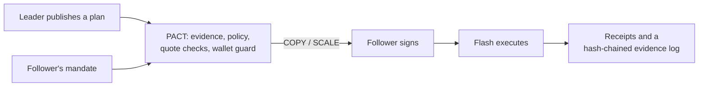

# PACT

**Non-custodial copy trading where the follower owns the rules.**

Leaders publish structured trade plans. Each follower's own mandate decides what to copy, how
much, and how to exit. The follower signs every order in their own wallet, and
[Definitive Flash](https://flash.definitive.fi) executes it. PACT never holds a private key or
custodies funds.

## Links

| | |
| --- | --- |
| **Live app** | https://pactfi.vercel.app |
| **Trading terminal** | https://pactfi.vercel.app/trade · [Discover](https://pactfi.vercel.app/discover) · [Proposals](https://pactfi.vercel.app/proposals) · [Orders](https://pactfi.vercel.app/execution) |
| **Docs** | [`docs/`](docs/README.md) |
| **Real copy on Base** | [Fill 1](https://basescan.org/tx/0x0d3ed912328e1379a60a8506eb6a53b24e52bb7a7d85c68878a376e05fe25474) · [Fill 2](https://basescan.org/tx/0x682b4fd438bc90dbe5b49d24bb09e565e5f7f76a28744f107e5f9a39225f3a81) (details [below](#a-real-copy-on-base)) |



## Why

Copy trading works for leaders more often than for the people copying them: followers get a
worse entry, a size that does not fit, costs that erase the edge and an exit they do not
control, and some leaders use their followers as exit liquidity. PACT copies the **plan**, not
the position, under rules the follower owns, and checks every step with evidence.

## What it does

- **Mandates:** up to ten leaders, each with its own sizing (proportional, fixed or
  stop-risk), daily sleeve, order types and exit, inside portfolio caps.
- **Policy before price:** COPY, SCALE, WAIT, REVIEW or DECLINE with reasons, before anything
  is quoted; real-price checks (Chainlink, impact, drift, cost) before anything is signed.
- **Wallet guard:** the browser re-checks Flash's payloads before the wallet signs.
- **Follower-owned exits:** a Flash TP/SL pair on the follower's own position.
- **Leader evidence:** the leader's own Flash order and Base trades, checked against the plan.
- **Follower fairness:** detects leaders who front-run or sell into their followers' buys.
- **Verified humans:** World ID, one unique human per leader address.
- **Autopilot:** an optional session key limited on chain by the follower's PACT wallet.
- **Evidence log:** every decision and order, hash-chained and verified in the browser.

## A real copy on Base

On 7 Nov 2026 a leader published a live ETH plan. One follower copied it for **$5** (the
leader's own size was $100). The copy went through PACT end to end: mandate, quote checks,
wallet guard, the follower's signatures, then Flash executed it on Base.

| Step | Onchain | Result |
| --- | --- | --- |
| USDC approval to Permit2 | [`0xdd5c…58e7`](https://basescan.org/tx/0xdd5cd152731a268091cea9757102227e6cb535ea7ed4e930ffa0b582b9b458e7) | Success, block 54,117,215 |
| WETH approval to Permit2 (for the stop/target) | [`0xaefe…2104`](https://basescan.org/tx/0xaefee24c0f1cca6fad8902fd6092f2fc9949edfd2cacb54e8172f6b4e0ab2104) | Success, block 54,117,230 |
| TWAP slice 1, settled by Flash | [`0x0d3e…5474`](https://basescan.org/tx/0x0d3ed912328e1379a60a8506eb6a53b24e52bb7a7d85c68878a376e05fe25474) | $2.92 USDC → WETH, block 54,117,247 |
| TWAP slice 2, settled by Flash | [`0x682b…3a81`](https://basescan.org/tx/0x682b4fd438bc90dbe5b49d24bb09e565e5f7f76a28744f107e5f9a39225f3a81) | $2.08 USDC → WETH, block 54,119,899 |

- **Flash order:** `ad844b93-00da-4383-af61-019c32461bd7`. A TWAP of 2 slices over 10 minutes,
  limit price $2,261.51 (the follower's 1% maximum entry drift), with the follower's own TP/SL
  attached: target $2,328.69, stop $2,194.34.
- **Follower wallet:** [`0x7c08…C5A5`](https://basescan.org/address/0x7c08305451147C8372266D4F332D5719F479C5A5).
  It signed every order itself; PACT never held funds or keys.
- **Execution:** $2,239.56 before fees, against the leader's declared entry of $2,239.12
  (**+2.0 bps**). Fees **$0.059**, against $0.131 quoted. Gas for the two approvals was about $0.001.
- **Receipt:** 5/5 MATCH against Flash's own report: price inside the bound, fees as quoted or
  lower, proceeds to the follower, PACT's fee as disclosed, live stop/target levels as chosen.
- **Onchain attribution:** both settlement transactions carry ERC-8021 builder codes in their
  calldata, `bc_lv99qw8t` (Definitive) and `pactfi` (PACT). PACT decodes them from Base, so the
  chain alone shows these fills came through a PACT copy.
- **PACT's fee:** 0. The leader was on probation, and PACT charges only on copies of proven leaders.

## Documentation

| | |
| --- | --- |
| [Overview](docs/README.md) | What PACT is |
| [Concepts](docs/concepts.md) | Plans, mandates, proposals, decisions, receipts |
| [How it works](docs/how-it-works.md) | One copy from plan to fill |
| [Trading principles and formulas](docs/trading-principles.md) | The rules and the maths |
| [Policy engine](docs/policy.md) | Every check and reason code |
| [Execution](docs/execution.md) | Flash quotes, signing, tracking, receipts |
| [Leaders](docs/leaders.md) | Publishing, evidence, probation, conduct, World ID |
| [Security and trust model](docs/security.md) | Who can sign what; the wallet guard; Autopilot |
| [Architecture](docs/architecture.md) | The layers L0 to L7 |
| [API reference](docs/api.md) | HTTP endpoints |
| [Operations](docs/operations.md) | Run, configure, test, deploy |

## Repository

```text
pact/        the app (Next.js), contracts (Foundry), tests
docs/        product documentation
PACT.md      product brief: features, verification, constraints, roadmap
```

## Quick start

```bash
cd pact
npm install
cp .env.example .env.local   # set FLASH_API_KEY
npm run dev                  # http://localhost:3000
```

PACT is unaudited software and not investment advice.
