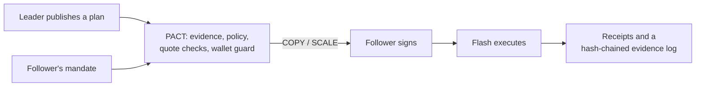

# PACT

**Non-custodial copy trading where the follower owns the rules.**

Leaders publish structured trade plans. Each follower's own mandate decides what to copy, how
much, and how to exit. The follower signs every order in their own wallet, and
[Definitive Flash](https://flash.definitive.fi) executes it. PACT never holds a private key or
custodies funds.

**Live:** https://pactfi.vercel.app · **Docs:** [`docs/`](docs/README.md)



## Why

Copy trading works for leaders more often than for the people copying them: followers get a
worse entry, a size that does not fit, costs that erase the edge and an exit they do not
control, and some leaders use their followers as exit liquidity. PACT copies the **plan**, not
the position, under rules the follower owns, and checks every step with evidence.

## What it does

- **Mandates:** up to ten leaders, each with its own sizing (proportional, fixed or
  stop-risk), daily sleeve, order types and exit, inside portfolio caps.
- **Policy before price:** COPY, SCALE, WAIT, REVIEW or DECLINE with reasons, before anything
  is quoted; real-price checks (Chainlink, impact, drift, cost) before anything is signed.
- **Wallet guard:** the browser re-checks Flash's payloads before the wallet signs.
- **Follower-owned exits:** a Flash TP/SL pair on the follower's own position.
- **Leader evidence:** the leader's own Flash order and Base trades, checked against the plan.
- **Follower fairness:** detects leaders who front-run or sell into their followers' buys.
- **Verified humans:** World ID, one unique human per leader address.
- **Autopilot:** an optional session key limited on chain by the follower's PACT wallet.
- **Evidence log:** every decision and order, hash-chained and verified in the browser.

## Documentation

| | |
| --- | --- |
| [Overview](docs/README.md) | What PACT is |
| [Concepts](docs/concepts.md) | Plans, mandates, proposals, decisions, receipts |
| [How it works](docs/how-it-works.md) | One copy from plan to fill |
| [Trading principles and formulas](docs/trading-principles.md) | The rules and the maths |
| [Policy engine](docs/policy.md) | Every check and reason code |
| [Execution](docs/execution.md) | Flash quotes, signing, tracking, receipts |
| [Leaders](docs/leaders.md) | Publishing, evidence, probation, conduct, World ID |
| [Security and trust model](docs/security.md) | Who can sign what; the wallet guard; Autopilot |
| [Architecture](docs/architecture.md) | The layers L0 to L7 |
| [API reference](docs/api.md) | HTTP endpoints |
| [Operations](docs/operations.md) | Run, configure, test, deploy |

## Repository

```text
pact/        the app (Next.js), contracts (Foundry), tests
docs/        product documentation
PACT.md      product brief: features, verification, constraints, roadmap
```

## Quick start

```bash
cd pact
npm install
cp .env.example .env.local   # set FLASH_API_KEY
npm run dev                  # http://localhost:3000
```

PACT is unaudited software and not investment advice.
