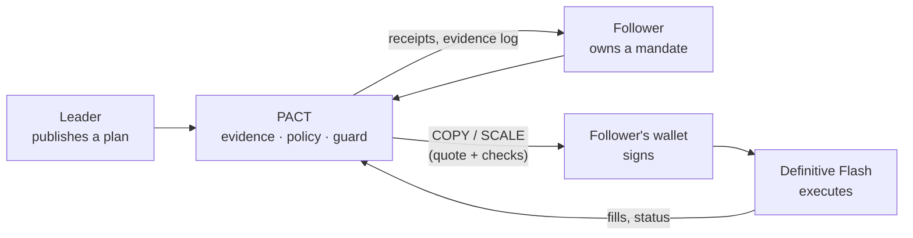

# PACT documentation

**PACT is non-custodial copy trading where the follower owns the rules.**

Leaders publish structured trade plans. Each follower's own mandate decides what to copy,
how much, and how to exit. The follower signs every order in their own wallet (or through a
session key they created and limited on chain), and [Definitive Flash](https://flash.definitive.fi)
executes it. PACT never holds a private key or custodies funds.

Live app: **https://pactfi.vercel.app**

## Start here

| If you want to… | Read |
| --- | --- |
| Understand what PACT is and the words it uses | [Concepts](concepts.md) |
| Follow one copy from plan to fill | [How it works](how-it-works.md) |
| Understand the trading rules and the maths | [Trading principles and formulas](trading-principles.md) |
| See every decision rule and reason code | [Policy engine](policy.md) |
| See how orders reach Flash and come back | [Execution](execution.md) |
| Publish plans as a leader, or judge a leader | [Leaders](leaders.md) |
| Understand who can sign what, and what PACT checks | [Security and trust model](security.md) |
| See the system's layers and modules | [Architecture](architecture.md) |
| Integrate with the HTTP API | [API reference](api.md) |
| Run, configure, test or deploy PACT | [Operations](operations.md) |

## What PACT does differently

- **Follower-owned mandates.** Up to ten leaders, each with its own sizing, daily sleeve,
  order types and exit, inside portfolio-wide caps the follower sets.
- **Policy before price.** Every plan gets a decision (COPY, SCALE, WAIT, REVIEW or
  DECLINE) with its reasons before anything is quoted. A blocked plan never reaches Flash.
- **The browser checks what you sign.** Recipient, tokens, amounts, spender, fee vault and
  deadline in Flash's payload are re-checked in the page before the wallet is asked.
- **Your exit, not the leader's.** A Flash TP/SL pair sits on the follower's own position.
  PACT never mirrors a leader's exit.
- **Evidence, not claims.** A leader's plan can be backed by their own Flash order and Base
  trades; a plan the leader's own execution contradicts is held for every follower.
- **Follower fairness.** PACT flags a leader who traded well before publishing at a better
  price, or whose asset left their wallet while followers' copies were filling. A repeat
  holds new copies.
- **Verified humans.** With World ID a leader proves one unique human is behind their
  wallet; one human backs one leader address.
- **Everything on the record.** Every decision, quote, order and finding joins an
  append-only, hash-chained evidence log that the browser verifies.

## What PACT will never do

- Hold your private key or your funds.
- Place a trade you did not sign, or that a session key you created and limited on chain
  did not sign.
- Invent PnL, win rates or leader rankings. Numbers come from Flash fills and on-chain
  records, or they are not shown.
- Claim to see what it cannot: it reads Flash and Base, not centralized exchanges or other
  chains.

## Status

PACT runs end to end against live Flash on Base and Arc: real quotes, the browser wallet
guard, real EIP-712 signatures, and Flash verifying them. World ID is integrated and tested
on World's staging network. Still to record: a funded mainnet fill, a funded Arc fill, a
production World ID proof from World App, and a live Autopilot session (its contracts are
not deployed yet). PACT is unaudited software and not investment advice.
