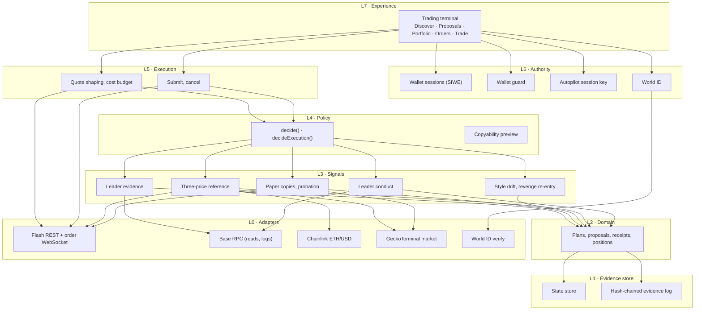
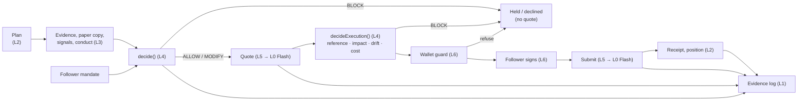
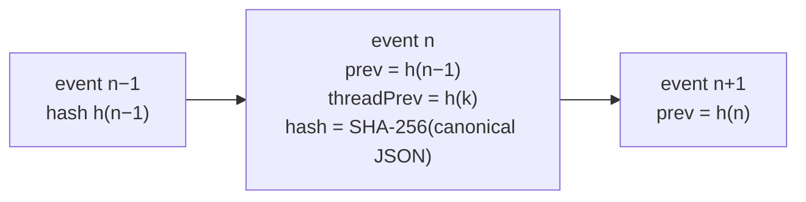

# Architecture

PACT is built in layers. Each layer's facts are kept apart from the layer that judges them:
adapters only read, signals only describe, policy only decides, and only the follower (or a
session key the chain limits) signs.

## Layers

| Layer | Responsibility | Never does | Key modules (`pact/`) |
| --- | --- | --- | --- |
| **L0 Adapters** | Talk to Flash (REST and order WebSocket), Base RPC, Chainlink, GeckoTerminal, World ID | Interpret what it reads | `lib/flash.ts`, `lib/flash-stream.ts`, `lib/base-rpc.ts`, `lib/oracle.ts`, `lib/market.ts`, `lib/wallet-facts.ts` |
| **L1 Evidence store** | Keep state; append every event to the hash-chained log | Change history | `lib/store.ts`, `lib/evidence.ts`, `lib/evidence-verify.ts` |
| **L2 Domain** | Plans, proposals, receipts, fills, positions and P&L from Flash fills | Price or judge | `lib/types.ts`, `lib/receipts.ts`, `lib/positions.ts`, `lib/tracker.ts` |
| **L3 Signals** | Describe facts: leader evidence, paper copies, style drift, revenge re-entry, three prices, conduct | Decide | `lib/leader-evidence.ts`, `lib/leader-verify.ts`, `lib/shadow*.ts`, `lib/signals.ts`, `lib/reference.ts`, `lib/conduct*.ts` |
| **L4 Policy** | Turn mandate + facts into a decision with reasons | Sign or submit | `lib/policy.ts`, `lib/copyability.ts` |
| **L5 Execution** | Shape Flash quotes, enforce the cost budget, submit and cancel | Hold a key | `lib/copy-quote.ts`, `lib/submit-order.ts`, `app/api/quote`, `app/api/order` |
| **L6 Authority** | Prove who speaks for a wallet; check payloads; bound automation; verify humans | Widen a follower's limits | `lib/session.ts`, `lib/guard.ts`, `lib/autopilot.ts`, `lib/session-account.ts`, `lib/world*.ts`, `contracts/` |
| **L7 Experience** | The trading terminal | Show numbers it cannot source | `components/`, `app/` |

## Data flow for one copy

## The evidence log

Every mandate change, plan, decision, quote, submit, rejection, status change, cancel,
leader evidence, paper copy, conduct finding, World ID verification and Autopilot action is
an event in an append-only log (`<store>.evidence.jsonl`).

- `hash = SHA-256(canonical JSON of the event without its hash)`.
- `prev` links each event to the previous event in the whole log; `threadPrev` links it to the
  previous event in its own thread (one proposal, one plan, one mandate, one leader).
- The browser downloads a thread and recomputes every hash and link (`verifyThread`). Editing
  or deleting any event breaks the chain and shows as **BROKEN**.
- Public events carry digests, never secrets: a World ID nullifier is stored as a SHA-256
  digest, and session keys never appear.

## Storage

State is a JSON store (`PACT_STORE_FILE`, default `.data/store.json`) with sidecar files
beside it: `.evidence.jsonl` (the log), `.grants.json` (Autopilot grants, keys AES-GCM
encrypted), `.humans.json` (World ID bindings) and `session-secret` (when
`PACT_SESSION_SECRET` is unset). See [Operations](operations.md).

## Frontend structure

One navigation system, single-sourced in `components/AppShell.tsx`:

- **Header:** the five workspaces: Trade · Discover · Proposals · Portfolio · Orders.
- **Rail, top:** the sections of the current workspace (for example Discover: Leaders ·
  Following · Watchlist).
- **Rail, bottom ("You"):** My Plans · Mandate · Settings, on every page.
- **Account menu:** the wallet (value, desk, disconnect) and tools.

Every route belongs to exactly one place, and every object has one canonical URL: leader
`/leaders/[address]`, plan `/plans/[id]`, proposal `/review/[id]`, order `/orders/[id]`.
Filters, tabs and the selection live in the URL, so back and forward work.
