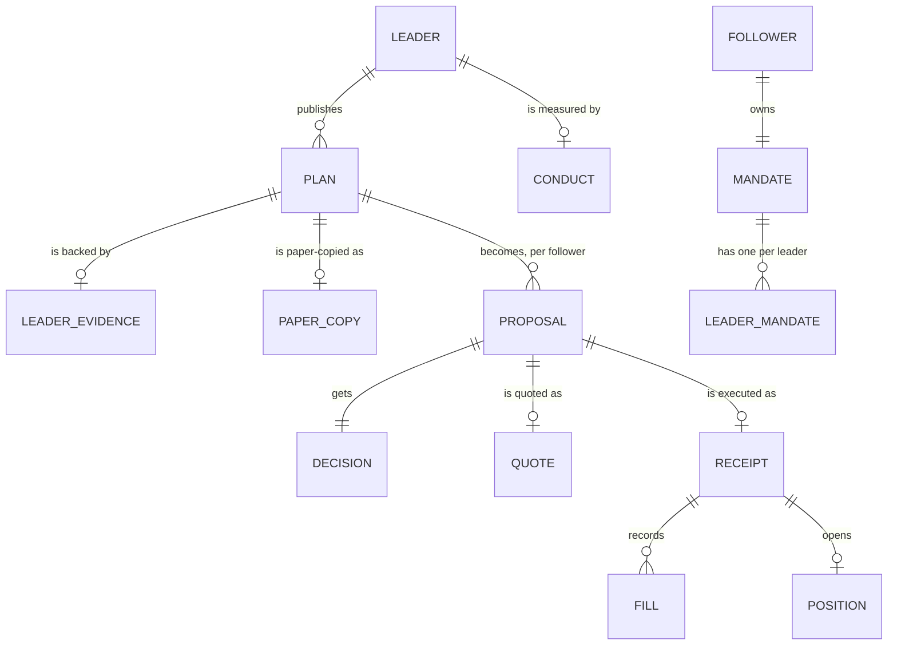

# Concepts

The words PACT uses, and how they relate.

## People

**Leader.** A wallet that publishes trade plans for others to copy. A leader needs no funds
on PACT and never touches a follower's money.

**Follower.** A wallet that selects leaders and owns a mandate. Every follower order is
signed by the follower's wallet, or by an Autopilot session key the follower created.

**Desk.** One follower's view of PACT: their mandate, proposals, positions and orders.
DEMO desks are seeded, labelled DEMO everywhere, and read-only.

## Plans

**Plan.** A leader's structured declaration of a trade: pair, chain, side, Flash order type
(market, limit or TWAP), quantity, reference entry, stop, target, invalidation, an entry
window (how long it can be copied), a protection window (how long the stop and target
stay live) and follower capacity (the most one follower may copy). A plan is a claim, not
an execution.

**Plan grade.** `DISCIPLINED` (entry, stop and target in the right order, reward:risk at or
above the minimum), `CAUTION` (reward:risk below the minimum) or `INCOMPLETE` (a level is
missing or misplaced). See [formulas](trading-principles.md#reward-to-risk-and-plan-grade).

**Leader evidence.** What PACT verified about the leader's own execution of a plan: their
Flash order and their Base transactions, compared with the plan. See [Leaders](leaders.md).

**Paper copy.** PACT's own copy of each new plan at Flash's real all-in quote, with no
signature and no money, settled on market candles. Paper copies decide a leader's probation.

**Leader conduct.** Whether a leader traded against their followers: getting in long
before publishing at a better price, or selling while followers were buying.

## Followers

**Mandate.** The follower's rules: portfolio-wide caps (per order, per day, open plans,
same-asset exposure, entry drift, impact, slippage, cost) and optional gates (plan quality,
evidence, probation, verified humans, conduct is always on).

**Leader mandate.** The follower's rules for one leader: sizing mode and value, daily
sleeve, allowed order types, and exit mode.

**Sleeve.** The most a follower copies from one leader per day.

**Sizing modes.** *Proportional* (a share of the leader's size), *fixed* (a fixed dollar
amount) or *stop-risk* (the most the follower would lose at the leader's stop).

## Decisions and execution

**Proposal.** One plan, sized for one follower, with PACT's decision attached.

**Decision.** `COPY`, `SCALE`, `WAIT`, `REVIEW` or `DECLINE`, with machine-readable reasons.
COPY and SCALE are policy decisions, not execution statuses. Following a leader never
places a trade. See [Policy engine](policy.md).

**Quote.** Flash's executable price for the follower's size, with fees, price impact and
the payloads to sign.

**Wallet guard.** The browser's check of Flash's payloads before the wallet is asked to
sign. See [Security](security.md#the-wallet-guard).

**Protection.** A Flash take-profit / stop-loss pair attached to the follower's entry, on
the follower's own position.

**Receipt.** What happened to a submitted copy: Flash order, status, fills with
transaction hashes, average fill, drift from the leader's entry, fees, protection, and
MATCH / MISMATCH verdicts.

**Position.** A filled buy copy, computed from Flash's own fill rows, marked at Flash's exit
quote.

**Evidence log.** An append-only, hash-chained record of every decision, quote, order and
finding. See [Architecture](architecture.md#the-evidence-log).

## Authority

**Wallet session.** A gasless Sign-In with Ethereum message that proves a browser speaks
for a wallet, for 12 hours. Required for every write.

**Autopilot.** Optional automation: a session key that can sign copies only within limits
the follower's PACT wallet enforces on chain. See [Security](security.md#autopilot).

**Verified human.** A leader who proved with World ID that one unique human is behind
their wallet.
