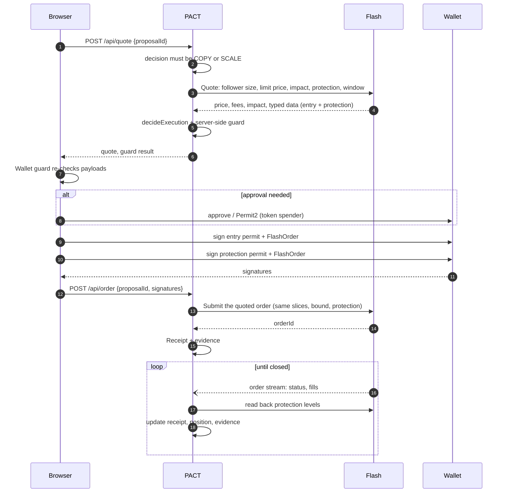

# Execution

How a decided copy becomes a Flash order, and how PACT follows it to the end.

## Quote

PACT asks Flash for a quote at the follower's size (after any SCALE), with:

- the follower's **price bound** as the limit price on TWAP and limit copies (see
  [formulas](trading-principles.md#the-followers-price-bound));
- **slippage** limits on market orders and **price-impact** limits on advanced orders, sent on
  the quote and echoed on submit;
- a **TWAP** shaped to finish inside the plan's entry window, with the leader's slice count if
  declared. A small TWAP whose automatic slices exceed the cost budget is re-quoted once with
  two slices, and that count is used on submit;
- a resting limit copy that expires with the plan's entry window;
- the follower's **TP/SL pair** when the mandate's exit mode is a bracket, with an expiry never
  earlier than the entry's;
- the follower's wallet (or PACT wallet, for Autopilot) as funder.

The quote is then checked again with real prices (`decideExecution`): three prices, impact,
drift and cost. Only then is it returned to the browser.

## Signing

Flash orders are EIP-712 typed data on the `DefinitiveFlashAllowance` domain. A Flash order
signature binds the swapper, the fee vault, the **recipient**, the tokens, the **maximum spend**,
a salt and the **deadline**. Spending is authorised either by a direct token approval or by a
Permit2 permit; protection orders carry their own permit.

The browser shows every prompt only after the wallet guard passes (see
[Security](security.md#the-wallet-guard)). A typical first copy asks for: one or two token
approvals (gas), then permits and orders for the entry and the protection.

## Who enforces what

| Control | Enforced by |
| --- | --- |
| Recipient, tokens, maximum spend, fee vault, deadline | The follower's signature (Flash verifies it, on chain when executing) |
| Limit price (the follower's bound) | Flash's execution engine |
| TP/SL triggers | Flash's execution engine |
| Policy (caps, gates, holds) | PACT, before quoting |
| Quote checks (prices, impact, drift, cost) | PACT, before signing |
| Payload contents | The follower's browser (wallet guard) |
| Autopilot limits | The follower's PACT wallet contract, on chain |

Because the price bound and triggers are not inside the signature, PACT reads the live levels
back from Flash after submit and flags any difference from what the follower chose.

## Tracking

PACT follows each live order over **Flash's order WebSocket** (one scope per connection, with
heartbeats) and falls back to REST polling every few seconds when the stream is unavailable
(`PACT_ORDER_STREAM=off` forces polling). Each update refreshes the receipt; new fills
trigger a leader-conduct check.

## Receipts

A receipt records:

- the leader's declared entry, Flash's quoted price and all-in price;
- the Flash order ID, status and close reason;
- fill rows with transaction hashes, TWAP progress, the volume-weighted average fill;
- entry drift in bps, fees (finalized fills only);
- the protection's status, live levels and its own fills;
- MATCH / MISMATCH verdicts for the price bound, fees, recipient, integrator fee and
  protection levels.

Each order's evidence bundle (`/api/orders/[id]/evidence?download`) contains Flash's order and
fills, PACT's decision and quote, and the hash-chained trail for that copy.

## PACT's fee

PACT charges a fee only on copies of a leader who has earned it (`lib/fees.ts`). The fee is
decided before the quote and sent to Flash as `flashIntegratorFeeBps`, identically on
`POST /quote` and `POST /order`. Flash includes it in the quoted all-in cost and collects it at
execution.

| Leader | Fee on the copy |
| --- | --- |
| Graduated from probation, clean conduct | `PACT_FEE_BPS` (default 10 bps = 0.10%) |
| On probation (fewer than 3 settled paper copies, or a contradicted plan) | none |
| Conduct caution or alert (front-running, selling into followers) | none |
| Any leader, while PACT runs on Flash's shared playground key | none (the fee would go to that shared account) |

The review screen and the decision trace show the fee or the reason it is waived. The receipt
records the decision, sums `integratorFeeNotional` from Flash's finalized fill rows as the fee
actually collected, and checks that Flash's order carries exactly the disclosed rate.

## Onchain attribution

Every copy carries PACT's ERC-8021 builder code (`FLASH_BUILDER_CODE`, sent as
`erc8021AttributionCode` on `POST /order`). Flash appends it to the settlement transaction's
calldata after Definitive's own code. The Orders page reads each fill's transaction from Base,
decodes the suffix (`lib/erc8021.ts`, `/api/orders/[id]/attribution`), and shows **SETTLED
THROUGH PACT** when PACT's code is there. This proves from the chain alone that the fill came
through a PACT copy.

## Cancelling

Cancelling a copy cancels the entry **and** its live protective order with one signature
(Flash batch cancel). The follower signs the cancel in their wallet.

## Positions

A filled buy becomes a position computed from Flash's own fill rows; the protection's fills
close it. Open positions are marked at Flash's executable sell quote. See
[formulas](trading-principles.md#after-the-fill).

## Chains

| Chain | Status |
| --- | --- |
| **Base** (8453) | Primary. Quote, guard, sign and submit validated end to end against live Flash. |
| **Arc** (5042) | Same flow, opt-in per mandate. Validated up to Flash's balance check. |

The supported pair is WETH/USDC, spot only.
