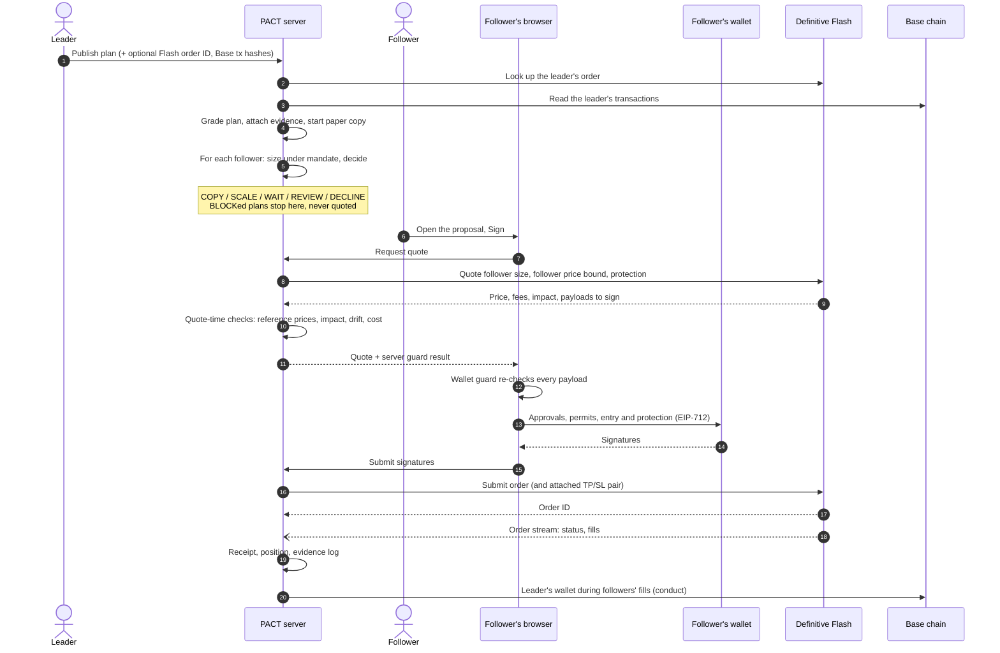

# How it works

One copy, from a leader's plan to a filled order and its receipt.

## 1. A leader publishes a plan

The leader signs in with their wallet and publishes a plan: pair, side, Flash order type,
quantity, entry, stop, target, invalidation, entry window, protection window and follower
capacity. PACT validates the structure (`stop < entry < target` for a long) and grades it.

The leader can attach evidence: the ID of their own Flash order and Base transaction hashes.
PACT reads them itself and compares them with the plan. PACT also starts a **paper copy**: a
real Flash quote at the plan's size, with no signature, settled later on market candles.

## 2. PACT decides for every follower

For each follower who follows that leader, PACT sizes the copy under the follower's leader
mandate (proportional, fixed or stop-risk), then runs the policy engine against the
follower's caps, gates and the leader's evidence, probation, signals, conduct and identity.
The result is a **proposal** with a decision and its reasons.

- **COPY / SCALE:** the follower may review and sign. SCALE means a smaller size, and says why.
- **WAIT / REVIEW / DECLINE:** nothing can be signed. PACT never asks Flash for a quote on a
  blocked plan.

## 3. The follower reviews and signs

On the proposal review the follower sees the leader's levels on a live chart, their own
execution under the mandate, the policy check, and the Flash quote. At quote time PACT runs
a second set of checks with real prices: Chainlink, the chart and Flash must agree, and
price impact, drift from the leader's entry and execution cost must be inside the mandate.

The follower's browser then re-checks Flash's payloads (the **wallet guard**) and only then
asks the wallet to sign: token approvals or permits, the entry order, and the protective
TP/SL pair.

## 4. Flash executes; PACT records

PACT submits the signed order to Flash and follows it over Flash's order stream (with REST
polling as a fallback). Each fill is read back with its transaction hash. The receipt
records the average fill, drift from the leader's entry, fees, the protection's live levels
and MATCH / MISMATCH verdicts. A filled buy becomes a **position**, marked at Flash's exit
quote. Every step joins the evidence log.

## 5. PACT keeps watching the leader

New follower fills trigger a **conduct** check: did the leader's asset leave their wallet
on Base while followers were buying? Did the leader get in long before publishing at a
better price? One occurrence is a caution; a repeat holds every follower's new copies of
that leader for review.

## Autopilot (optional)

With Autopilot, steps 3 and 4 run without the follower present: a session key signs the
same payloads, after the same policy and guard checks, but only inside limits the follower's
PACT wallet enforces on chain. See [Security](security.md#autopilot).
