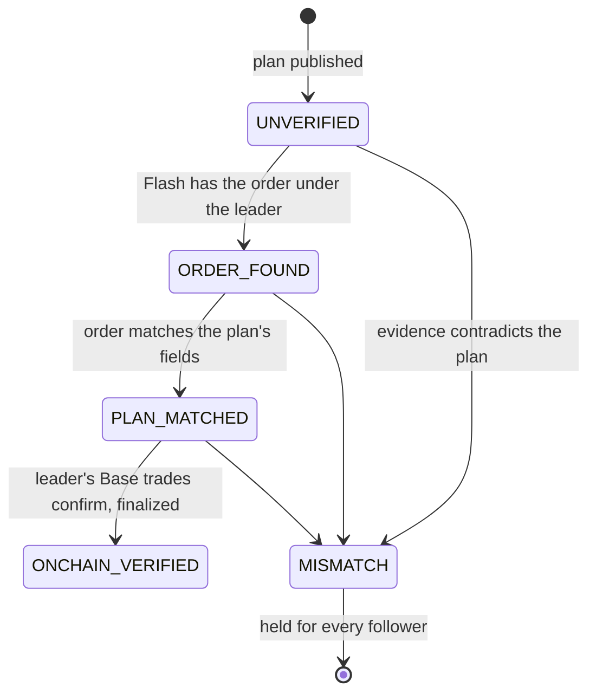
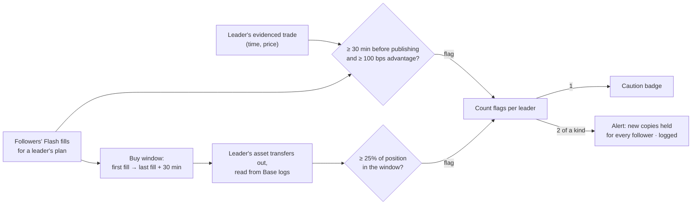

# Leaders

How leaders publish on PACT, and how PACT judges a leader from evidence rather than claims.

## Publishing a plan

A leader signs in with their wallet and publishes from **My Plans**:

| Field | Notes |
| --- | --- |
| Title, thesis, invalidation | What would make the idea wrong. Followers can require an invalidation. |
| Chain, pair, side | WETH/USDC on Base or Arc; buy or sell. |
| Order type | TWAP (duration, optional slices, optional start), limit, market. |
| Quantity | USDC spent for a buy; units sold for a sell. |
| Reference entry, stop, target | Validated: `stop < entry < target` for a long. |
| Optional price bound | A limit price; a stricter follower bound still wins. |
| Entry window | How long followers can copy. |
| Protection window | How long the follower's stop and target stay live (default 24 h). |
| Follower capacity | The most one follower may copy. |
| Evidence | Optional: the leader's own Flash order ID and Base transaction hashes. |

The plan is graded `DISCIPLINED`, `CAUTION` or `INCOMPLETE`
([formulas](trading-principles.md#reward-to-risk-and-plan-grade)) and gets a canonical page at
`/plans/[id]`.

## Execution evidence

PACT checks a leader's evidence itself, read-only:

- **Flash order:** looked up under the leader's wallet and compared with the plan's pair, side,
  order type, size, timing and price controls.
- **Base transactions:** receipts and ERC-20 transfers read from Base, including the leader's
  Flash fill transactions. Each transaction can back only one plan, and only finalized blocks
  count as final.

A **MISMATCH** holds the plan for every follower (`LEADER_EXECUTION_MISMATCH`). A follower can
also require a minimum evidence level (`LEADER_EXECUTION_UNVERIFIED`).

## Paper copies and probation

Every new plan is paper-copied at Flash's real all-in quote, with no signature, and settled
on market candles against its stop and target. A leader is **on probation** until 3 paper
copies have settled and none of their plans is contradicted. Followers can require a leader
to have passed probation. A leader whose paper copies mostly could not be copied within
default limits is marked **hard to copy**.

## Signals

- **Style drift:** a plan far above the leader's usual size; proportional copies are scaled
  back ([formula](trading-principles.md#sizing)).
- **Revenge re-entry:** a bigger re-entry within 24 h of a stop-out is held for review.

## Follower fairness (conduct)

PACT measures whether a leader traded against the followers who copied them, from facts it
already holds:

- **Traded well before publishing:** the leader's evidenced trade came at least 30 minutes
  before the plan, and followers paid at least 1% more.
- **Sold into followers' buys:** the plan's asset left the leader's wallet on Base while
  followers' copies were filling (up to 30 minutes after), at least 25% of the position.

Conduct is re-checked when followers' fills arrive and when the leader's profile is read. The
profile's **Follower fairness** panel shows each plan's numbers. PACT reads Base only: sales on
a centralized exchange, another chain or another wallet are not visible, and a transfer out
counts like a sale.

## Verified humans (World ID)

A leader can prove with World ID that one unique human is behind their wallet:

1. The leader signs in; PACT signs a World ID request (the RP signing key stays on the server).
2. World App produces a proof whose **signal is the leader's address**.
3. PACT checks environment, action and signal, then has World verify the proof.
4. PACT binds the proof's nullifier to the address. One human backs one leader address; a
   second address for the same human is refused.

Followers see a **Verified human** badge, can filter Discover by it, and can copy verified
humans only. World ID proves uniqueness, not trading skill.

## The leader profile

`/leaders/[address]` shows, from evidence only:

- **Overview:** the leader's wallet on Base (balances, activity, recent USDC/WETH flows),
  plans published, evidence, probation, copyability for the viewing follower.
- **Plans:** every plan with its grade and the viewing follower's decision.
- **Execution evidence:** follower fairness, then each plan's evidence checks.
- **Paper copies:** each paper copy's entry and outcome.

## Incentives

PACT pays leaders nothing today. The intended model ties leader revenue to followers'
outcomes, for example a share only above a follower sleeve's high-water mark, so that
dumping on followers costs the leader.
