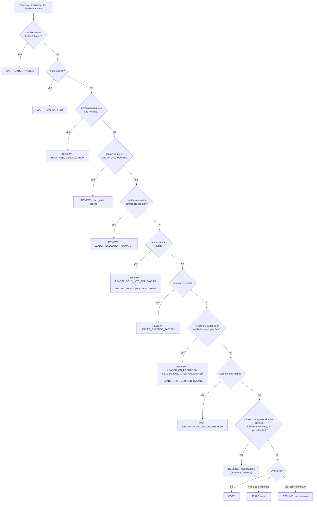
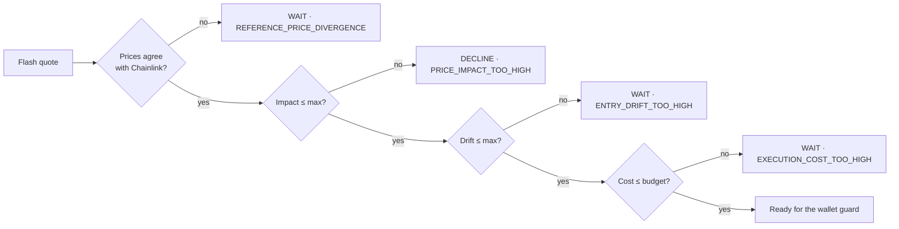

# Policy engine

The policy engine turns a follower's mandate and the facts about a plan into a decision with
reasons. It runs twice: when a plan becomes a proposal (`decide`), and again on Flash's real
quote (`decideExecution`). It never signs or submits anything.

## Decisions

| Decision | Verdict | Meaning | Can be signed |
| --- | --- | --- | --- |
| **COPY** | ALLOW | Fits the mandate as declared | yes |
| **SCALE** | MODIFY | Fits at a smaller size; the reasons say which cap | yes |
| **WAIT** | BLOCK | Not now: expired, a cap is full, prices disagree, paused, breaker | no |
| **REVIEW** | BLOCK | Held for the follower's eyes: plan incomplete, evidence missing or contradicted, probation, conduct, unverified human | no |
| **DECLINE** | BLOCK | Outside the mandate: pair, chain, side or order type not allowed; price unavailable | no |

## Order of checks

Holds are checked first and stop at the first hit; mandate limits are then collected
together, so the follower sees every reason at once.

Then, on Flash's quote:

The formulas behind each check are in [Trading principles and formulas](trading-principles.md).

## Reason codes

| Code | Decision | Meaning |
| --- | --- | --- |
| `LEADER_PAUSED` | WAIT | The follower paused this leader |
| `PLAN_EXPIRED` | WAIT | The plan's entry window has closed |
| `PLAN_NEEDS_INVALIDATION` | REVIEW | The plan has no invalidation and the follower requires one |
| `PLAN_NEEDS_ENTRY` / `_STOP` / `_TARGET` | REVIEW | A level is missing (quality gate) |
| `PLAN_INVALID_STOP_OR_TARGET` | REVIEW | Levels are not in the right order (quality gate) |
| `PLAN_REWARD_RISK_TOO_LOW` | REVIEW | R:R below the minimum (quality gate) |
| `LEADER_EXECUTION_MISMATCH` | REVIEW | The leader's own Flash order or Base trades contradict the plan |
| `LEADER_SOLD_INTO_FOLLOWERS` | REVIEW | The leader repeatedly sold while followers' copies were filling |
| `LEADER_FRONT_RAN_FOLLOWERS` | REVIEW | The leader repeatedly got in long before publishing at a better price |
| `LEADER_REVENGE_PATTERN` | REVIEW | A bigger re-entry within 24 h of a stop-out |
| `LEADER_ON_PROBATION` | REVIEW | Fewer than 3 settled paper copies (when required) |
| `LEADER_EXECUTION_UNVERIFIED` | REVIEW | Evidence below the follower's minimum (when required) |
| `LEADER_NOT_VERIFIED_HUMAN` | REVIEW | Not verified with World ID (when required) |
| `LEADER_LOSS_CIRCUIT_BREAKER` | WAIT | The leader's copies hit the daily loss limit (when enabled) |
| `STOP_RISK_PLAN_INVALID` | REVIEW | Stop-risk sizing needs a stop on the losing side |
| `PRICE_UNAVAILABLE` | DECLINE | A sell could not be priced |
| `CHAIN_NOT_ALLOWED` / `PAIR_NOT_ALLOWED` / `ORDER_TYPE_NOT_ALLOWED` / `SIDE_NOT_ALLOWED` | DECLINE | Outside the mandate |
| `SLIPPAGE_TOO_HIGH` / `PRICE_IMPACT_TOO_HIGH` | DECLINE | The plan's tolerance is looser than the mandate's |
| `SIZE_EXCEEDS_MAX` / `DAILY_CAP` / `LEADER_DAILY_CAP` / `ASSET_EXPOSURE_CAP` / `PLAN_CAPACITY` | SCALE or DECLINE | A cap is reached |
| `ACTIVE_PLAN_LIMIT` / `LEADER_ACTIVE_PLAN_LIMIT` | DECLINE | Too many open plans (in total, or from this leader) |
| `LEADER_SIZE_OUT_OF_CHARACTER` | SCALE | Plan far above the leader's usual size; proportional copy scaled back |
| `REFERENCE_PRICE_DIVERGENCE` | WAIT | Flash or the pool disagrees with Chainlink at quote time |
| `ENTRY_DRIFT_TOO_HIGH` | WAIT | Executable price too far from the leader's entry |
| `EXECUTION_COST_TOO_HIGH` | WAIT | Fees and value lost above the cost budget |

## Optional gates

The follower can switch these on in the mandate; all are off by default except the
invalidation requirement.

| Gate | Effect |
| --- | --- |
| Plan must have an invalidation | Plans without one are held (on by default) |
| Plan quality | Only DISCIPLINED plans can be copied |
| Leader execution evidence | Only plans with at least the chosen evidence level |
| Passed probation | Only leaders whose paper copies have settled |
| Verified humans only | Only leaders verified with World ID |
| Leader loss breaker | Stop copying a leader after a daily realized loss |
| World ID approval for Autopilot | A fresh human approval of the exact limits before a session key is created |

Leader conduct and contradicted evidence are always on: they protect every follower.

## Re-deciding

Decisions are inputs-driven. A waiting copy is re-decided when its inputs change: the
follower edits the mandate or pauses a leader, the leader's evidence status changes, the
leader passes probation, a loss trips the breaker, or a conduct hold starts or ends.
Re-deciding replaces only copies the follower has not acted on.
