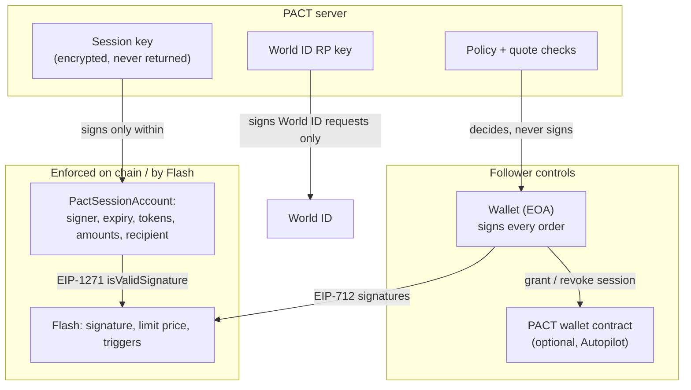

# Security and trust model

PACT is built so that the follower never has to trust PACT with their funds. This page says
who can sign what, what PACT checks, and where its guarantees stop.

## Authority

| Actor | Can | Cannot |
| --- | --- | --- |
| Follower's wallet | Sign orders, permits, cancels; grant and revoke an Autopilot session | — |
| PACT server | Decide, quote, submit signed orders, read chain and Flash | Sign an order with the follower's key; move funds; change a signed order |
| Autopilot session key | Sign Flash orders, Permit2 permits and cancels for the PACT wallet, within its on-chain scope | Withdraw, pay anyone but the follower, exceed amounts, outlive its expiry |
| Leader | Publish plans, attach evidence, verify as a human | Touch any follower's funds or mandate |

## The wallet guard

Before any wallet prompt, the follower's browser re-checks Flash's raw payloads for the entry
and the protection pair. A server-side guard runs the same checks, but the browser's check is
the one that counts: it runs where the signature is made.

| Check | Why |
| --- | --- |
| Recipient and swapper are the follower | Funds can only go back to the follower |
| Tokens and chain match the copy; the protection sells what the entry buys | No asset or chain swap |
| Amount equals the policy-approved size; protection may sell at most what the entry buys | No inflated spend |
| Permit2 or approval spender and amount | No open-ended allowance to an unknown spender |
| Integrator fee vault, when pinned (`NEXT_PUBLIC_FLASH_VAULT`) | No redirected fees |
| Signing domain and a future deadline | No replay on another domain; no stale order |

The guard proves **where funds can go**, not at what price. A tampered price or trigger could
only mis-time a trade back into the follower's own wallet, and the follower's limit price is
enforced by Flash's engine. In PACT's end-to-end tests a server that inflates the amount 20× is
refused before the wallet is asked for anything.

## Wallet sessions

Writes (saving a mandate, publishing, quoting, submitting, Autopilot, World ID) require a
Sign-In with Ethereum session:

1. `POST /api/session/nonce` returns an EIP-4361 message for the address.
2. The wallet signs it (gasless).
3. `POST /api/session` verifies the signature and sets an HMAC cookie for 12 hours.

A write without a session returns **401**; a write for another wallet returns **403**.

## Autopilot

Autopilot lets copies be signed while the follower is away, without giving PACT a key the
chain does not limit.

- **`PactSessionAccount`** (`pact/contracts`): an EIP-7702 / clone account deployed by
  `PactAccountFactory`. The follower grants and revokes a session key; the account validates
  signatures through **EIP-1271** for exactly three kinds: Flash orders, Permit2 permits and
  cancels. Its scope is checked on chain: who signs, until when, which tokens, the most per
  order and per permit, and that every order pays out to the follower's PACT wallet.
- PACT's policy, wallet guard, daily cap and evidence log apply on top.
- The session key is generated on the server, stored AES-GCM encrypted, and never returned.
- A session must outlast the protection it signs (default 72 h against 24 h protection),
  because Flash re-checks the signature when a stop fires.
- **World ID approval** (optional): the follower approves the exact limits in World App before
  the key is created; the proof's signal is the follower plus those limits, so it cannot be
  replayed for higher limits. The first approving human becomes the desk's approver.
- Until the contracts are deployed and `PACT_AUTOPILOT_SUBMIT=1`, Autopilot only dry-runs.
- Revoking is one transaction from the follower's wallet; PACT also stops signing at once.

## World ID

- The RP signing key never leaves the server; the browser receives only the signed request.
- PACT checks the proof's environment, action and signal before asking World to verify it.
- Nullifiers are stored as integers in a sidecar file; the public evidence log carries only a
  SHA-256 digest.
- World ID is identity only: it never authorizes a trade and says nothing about skill.

## Evidence integrity

Every event is hashed (SHA-256 over canonical JSON) and linked to the previous event and to
the previous event in its thread. The browser recomputes the chain; any edit or deletion shows
as broken. See [Architecture](architecture.md#the-evidence-log).

## Limits

- PACT has not been audited.
- Hosted state lives on the server's disk; on a serverless host it can reset (Flash keeps every
  order). See [Operations](operations.md).
- Leader conduct reads Base only.
- The supported market is WETH/USDC spot on Base and Arc; PACT offers no leverage, liquidation
  or funding controls.
- Planned-loss sizing is an estimate; gaps and unfilled stops can lose more.
